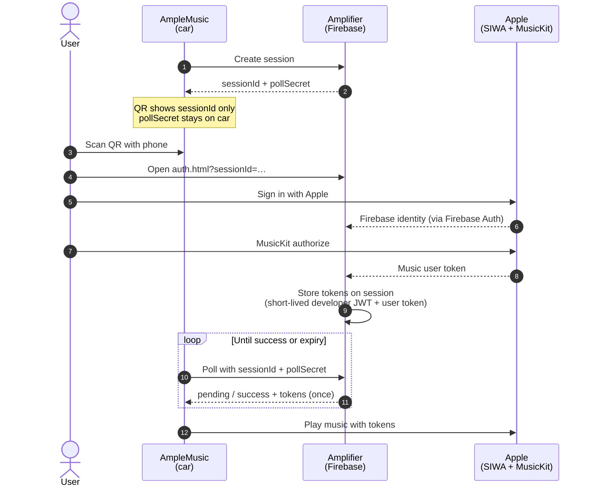

# Amplifier

Amplifier is the helper service for **AmpleMusic**, the Apple Music app in the car.

Logging into Apple Music on a car screen is awkward, so the car shows a QR code. You scan it on your phone, sign in there, and Amplifier passes the login back to the car so the car can play your music.

## Overview

Amplifier is a Firebase backend (Cloud Functions, Hosting, Firestore, Auth) that runs that cross-device login flow for the AmpleMusic Android automotive app.

**Key Features:**
- Cross-device authentication via QR codes
- Apple Music / MusicKit token handoff to the car
- Firebase Authentication (Sign in with Apple on the phone)
- Short-lived session management with cleanup
- Rate limiting and security controls

## How It Works

1. **Car app**: Creates a session, keeps a poll secret, shows a QR code (`sessionId` only)
2. **User**: Scans the QR code on a phone or computer
3. **Web page**: User signs in with Apple (Firebase Auth) and authorizes Apple Music (MusicKit)
4. **Backend**: Stores the completed session and short-lived tokens for the car
5. **Car app**: Polls with `sessionId` + poll secret until success, then receives tokens once



**Who does what**
- **AmpleMusic (car)** — starts the session, shows the QR, keeps the poll secret, then uses the tokens to talk to Apple Music.
- **Amplifier** — brokers the handoff: session, phone auth page, short-lived tokens, one-time delivery to the car.
- **Apple** — Sign in with Apple (who you are) and MusicKit (permission to use Apple Music). Those are two different steps.

## Prerequisites

- Node.js 24 (Cloud Functions 2nd gen runtime; keep local Node aligned)
- Firebase CLI
- Apple Developer Account with Music API access
- Firebase project with Authentication enabled

## Setup

### 1. Apple Developer Setup

1. Create Apple Music API key in [Apple Developer Console](https://developer.apple.com/account/)
2. Download the `.p8` private key file
3. Note your Key ID, Team ID, and Issuer ID

### 2. Firebase Configuration

```bash
# Create Firebase project
firebase login
firebase projects:create amplifier-backend

# Initialize functions
cd Amplifier
firebase use amplifier-backend
firebase init functions
```

### 3. Environment Setup

Params and secrets replace the old `functions.config()` / `.runtimeconfig.json` flow.

```bash
# Non-secret params (written to .env.<projectId> on first deploy, or set ahead of time)
cat >> .env.amplifier-backend <<'EOF'
APPLE_MUSIC_KEY_ID=YOUR_KEY_ID
APPLE_MUSIC_TEAM_ID=YOUR_TEAM_ID
APPLE_MUSIC_ISSUER=YOUR_ISSUER_ID
EOF

# Private key in Secret Manager (paste .p8 contents when prompted)
firebase functions:secrets:set APPLE_MUSIC_PRIVATE_KEY
```

For the emulator, put the same non-secret params in `.env` / `.env.local`, and the private key in `.secret.local` as `APPLE_MUSIC_PRIVATE_KEY=...` (never commit these files).

### 4. Deploy

```bash
npm install
npm run build
npm run deploy
```

Runtime is **Node.js 24** (`engines.node` and `firebase.json` `runtime: nodejs24`). Functions are **2nd gen**.

## API Endpoints

### POST /initializeSession
Creates a new authentication session for cross-device flow.

**Request:**
```json
{
  "sessionId": "unique-session-id",
  "firebaseIdToken": "firebase-auth-token"
}
```

### POST /completeAuthentication
Completes authentication and generates Apple Music tokens.

**Request:**
```json
{
  "sessionId": "unique-session-id",
  "firebaseIdToken": "firebase-auth-token"
}
```

**Response:**
```json
{
  "success": true,
  "userAccessToken": "apple-music-developer-token"
}
```

### GET /getSessionStatus?sessionId=xxx
Check authentication session status (used by car app).

**Response:**
```json
{
  "success": true,
  "status": "success|pending|error",
  "userAccessToken": "token-if-success"
}
```

### GET /health
Health check endpoint.

## Usage in AmpleMusic App

```kotlin
// 1. Generate session ID and display QR code
val sessionId = UUID.randomUUID().toString()
val qrUrl = "https://amplifier-backend.web.app/auth.html?sessionId=$sessionId"

// 2. Initialize session
val response = apiClient.initializeSession(sessionId, firebaseToken)

// 3. Poll for completion
while (true) {
    val status = apiClient.getSessionStatus(sessionId)
    if (status.status == "success") {
        val appleMusicToken = status.userAccessToken
        // Use token for Apple Music API calls
        break
    }
    delay(2000) // Poll every 2 seconds
}
```

## Security Features

Target model (see open GitHub issues for gaps still being closed):

- Firebase Authentication on the phone auth path
- Authenticated car polling and single-use token handoff
- Short-lived sessions with automatic cleanup
- Secrets in Secret Manager (not the repo)
- Rate limiting and locked-down CORS / auth hosting

## Project Structure

```
Amplifier/
├── src/
│   ├── index.ts              # Main Firebase Functions
│   └── apple-music-auth.ts   # Apple Music token generation
├── public/
│   ├── auth.html            # Cross-device auth web page
│   └── auth-success.html    # Success confirmation page
├── .cursor/
│   ├── rules/               # Persistent agent rules for this repo
│   └── skills/              # Project skill for developing Amplifier
├── firebase.json            # Firebase configuration
└── package.json             # Dependencies
```

## License

ISC License
